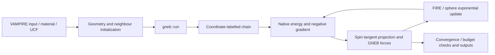

# 如何把GNEB接入VAMPIRE 7.0

推荐使用 `tools/install_extension.py`。本页解释其实际接入点，便于审阅和后续维护。上游源码固定为 `upstream.json` 中的7.0.0提交。

## 新增文件

|路径|职责|
|---|---|
|`hdr/gneb.hpp`|声明参数解析和 `gneb::run()`|
|`src/program/gneb_core.hpp`|与VAMPIRE全局数据解耦的几何、力和优化器|
|`src/program/gneb.cpp`|读取链、核验坐标、调用原生哈密顿量、写回执|

覆盖文件位于本仓库 `extension/`，其SHA记录在 `upstream.json`。

## 1. 解析 `gneb:*` 参数

在 `src/vio/match.cpp` 添加：

```cpp
#include "gneb.hpp"
```

并在模块参数路由中加入：

```cpp
else if(gneb::match_input_parameter(key, word, value, unit, line))
    return EXIT_SUCCESS;
```

本版路由放在 `program::match_input_parameter` 之前。GNEB解析器仅接收 `key == "gneb"`，未知参数会明确报错。

## 2. 注册 `sim:program=gneb`

在 `src/program/interface.cpp` 的 `word == "program"` 分支中加入：

```cpp
if(value == "gneb") {
    program::program = 80;
    return true;
}
```

`80`是在所固定7.0.0源码中的新程序ID。将补丁迁移到其他版本前，应重新检查ID是否冲突。

## 3. 加入执行调度

在 `src/simulate/sim.cpp` 包含 `gneb.hpp`，并在 `switch(program::program)` 中加入：

```cpp
case 80:
    gneb::run();
    break;
```

执行顺序是上游读取材料/UCF并建立邻居表，初始化能量模块，然后进入GNEB。GNEB不会调用LLG时间积分。

## 4. Makefile

在 `src/program/makefile` 的 `program_objects` 中加入：

```make
gneb.o \
```

并声明头文件依赖：

```make
obj/program/gneb.o: src/program/gneb_core.hpp hdr/gneb.hpp
```

这样修改内核头文件后，增量构建会重新编译GNEB对象。

## 5. 原生哈密顿量接口

每次评估图像时：

1. 按初始化后原子索引设置 `atoms::x/y/z_spin_array`。
2. 调用 `sim::calculate_spin_fields(0, atoms::num_atoms)`，复用交换和各向异性有效场。
3. 使用 `exchange::single_spin_energy` 及 `anisotropy::single_spin_energy` 计算能量。
4. 双向邻居表的交换能乘1/2；单格点各向异性与Zeeman项不乘1/2。
5. 按各材料磁矩把Tesla量转换成能量梯度，统一以meV交给GNEB内核。
6. 在图像自旋切平面上投影，再去除沿路径的物理力；弹簧只沿路径作用。

爬山像反转沿路径的物理力并去掉弹簧；固定端点不更新。切线在整幅3N维图像上归一化，不能把每个自旋的切线分别归一化。



## 兼容修正

接入补丁另外包含三项可审查的修正：

- `hdr/vmath.hpp`显式包含 `<cstdint>`。
- Win64/MinGW下Qhull使用足够容纳指针的整数类型。
- 各向异性参数解析器预留100个槽位，而磁矩数组只有实际材料数；初始化前将参数数组按实际材料数调整，防止越界读取。

这些修正均在 `patches/vampire-7.0.0-integration.patch` 中，没有加入额外交换或各向异性物理项。公开算例同时验证接入后的能量与梯度。

## 手动安装

若不使用安装器，应先核验版本和干净状态，再在上游根目录执行：

```bash
git apply --check /path/to/vampire-gneb/patches/vampire-7.0.0-integration.patch
git apply /path/to/vampire-gneb/patches/vampire-7.0.0-integration.patch
```

随后把本仓库 `extension/` 的三个文件按目录复制到上游，并保留 `LICENSE`、`NOTICES.md`、Spirit MIT以及上游各自许可证。重新构建并运行公开验收；只复制三个新文件而漏掉解析/调度/Makefile，入口不会生效。
